# 📵 Unplug: Digital Detox Pledge & Habit Tracker

A mobile web app that helps you use your phone less. Sign a detox pledge, and Unplug uses your phone's **motion sensors** to track face-down detox time, focus sessions and steps, with streaks and badges to keep you going.

**🔗 Live app:** https://digital-detox-habit-tracker.vercel.app/  ·  No login · No backend · Data stays on your device

---

## 🏠 Today

Your daily dashboard: progress rings, day streak, best streak, 30-day adherence, a 14-day trend chart, a 16-week heatmap, and today's pledges.

<table><tr>
<td align="center" valign="top" width="33%">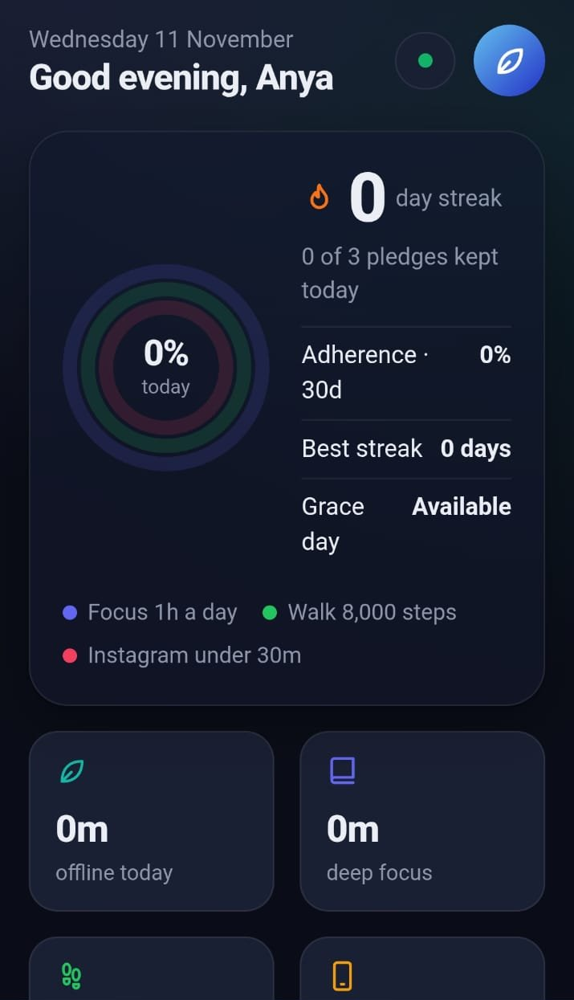<br><sub>Overview & streak</sub></td>
<td align="center" valign="top" width="33%">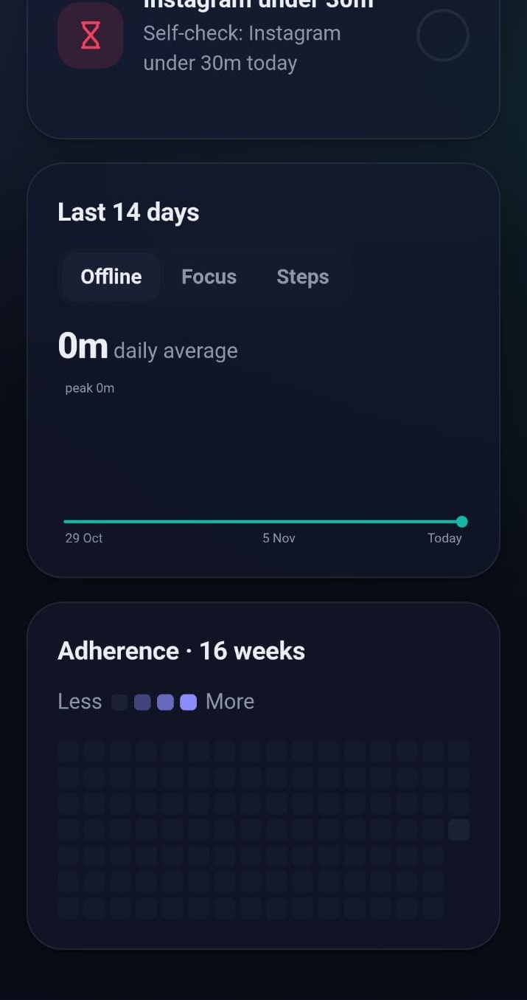<br><sub>Trends & heatmap</sub></td>
<td align="center" valign="top" width="33%">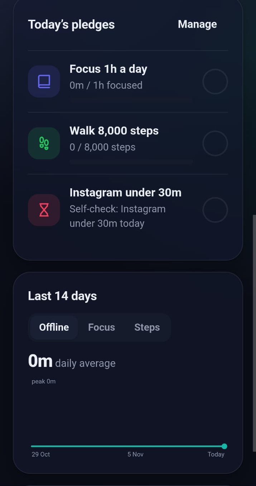<br><sub>Today's pledges</sub></td>
</tr></table>

## 📴 Detox

Start a 15–90 min **focus pledge**, or place your phone face-down to start a detox automatically. Picking up the phone or leaving the app is logged as a breach. Live telemetry shows the phone's tilt, motion and state.

<table><tr>
<td align="center" valign="top" width="50%">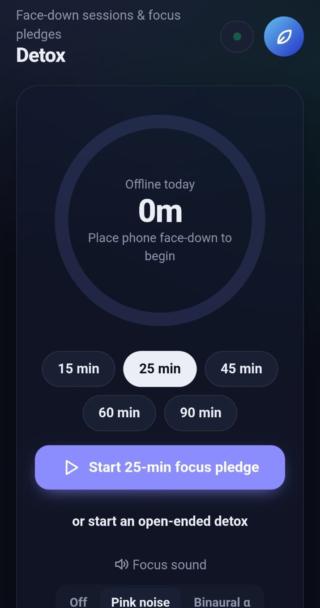<br><sub>Focus pledge timer</sub></td>
<td align="center" valign="top" width="50%">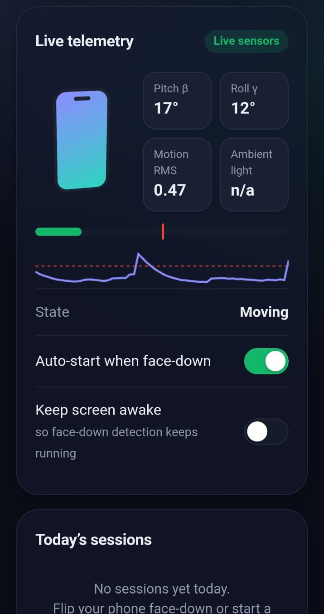<br><sub>Live sensor telemetry</sub></td>
</tr></table>

## 🚶 Steps

A step counter that uses the accelerometer. It shows distance, calories, cadence and active minutes. Walk mode keeps the screen on and pocket mode dims it. You also get hourly and 7-day charts.

<table><tr>
<td align="center" valign="top" width="25%">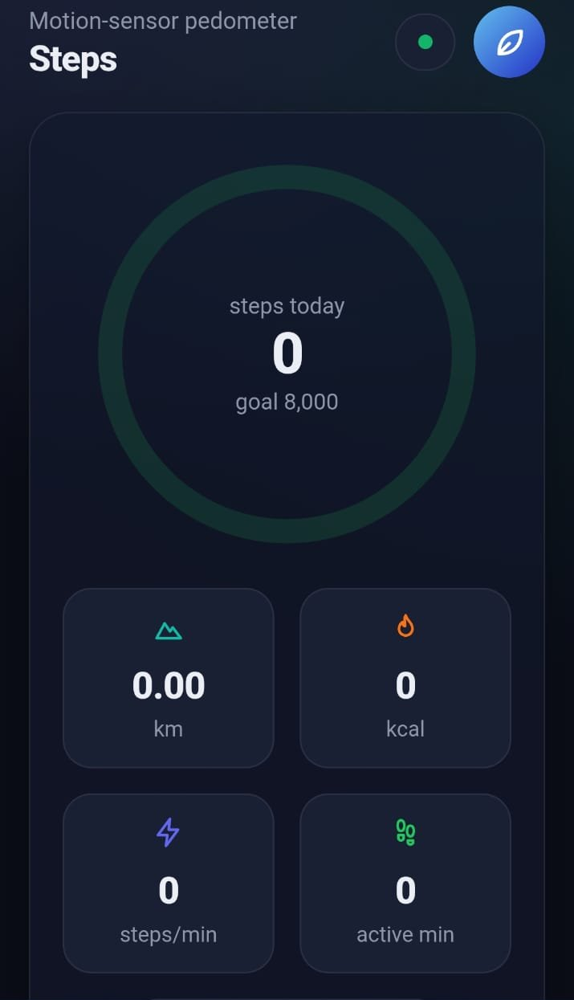<br><sub>Step counter</sub></td>
<td align="center" valign="top" width="25%">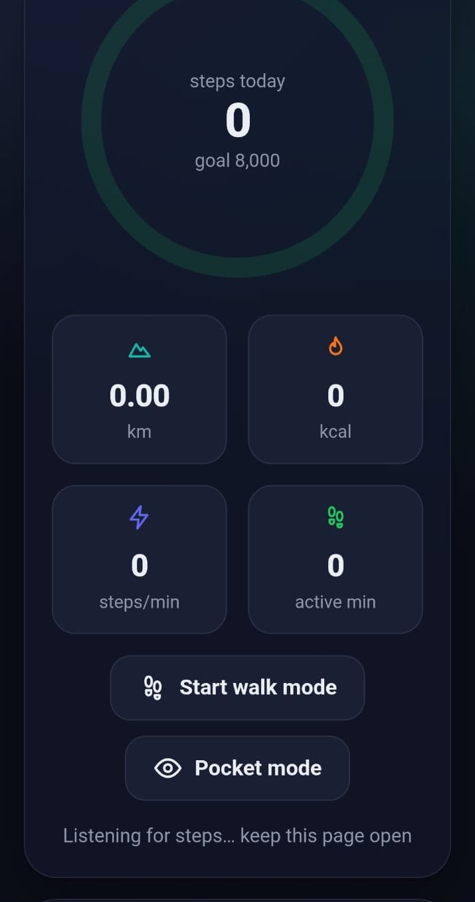<br><sub>Walk & pocket mode</sub></td>
<td align="center" valign="top" width="25%">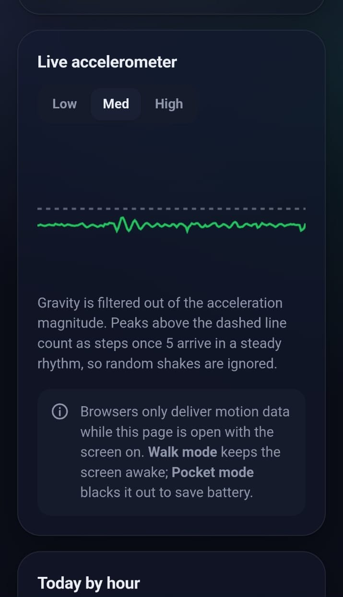<br><sub>Live accelerometer</sub></td>
<td align="center" valign="top" width="25%">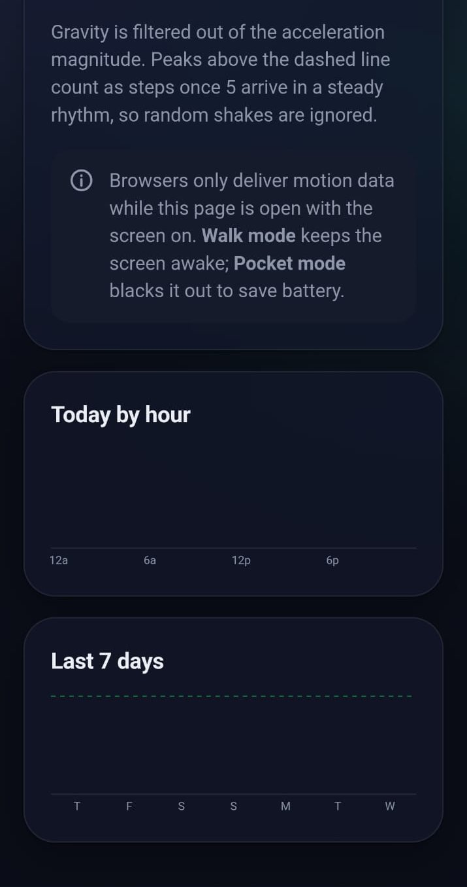<br><sub>Hourly & 7-day charts</sub></td>
</tr></table>

## 🛡️ Pledges & 🏅 Badges

A signed detox pledge card with 7 pledge types (offline, focus, steps, app limit, meals, sleep, custom). A day counts when you keep **75%** of your pledges. There are 12 badges to unlock.

<table><tr>
<td align="center" valign="top" width="33%">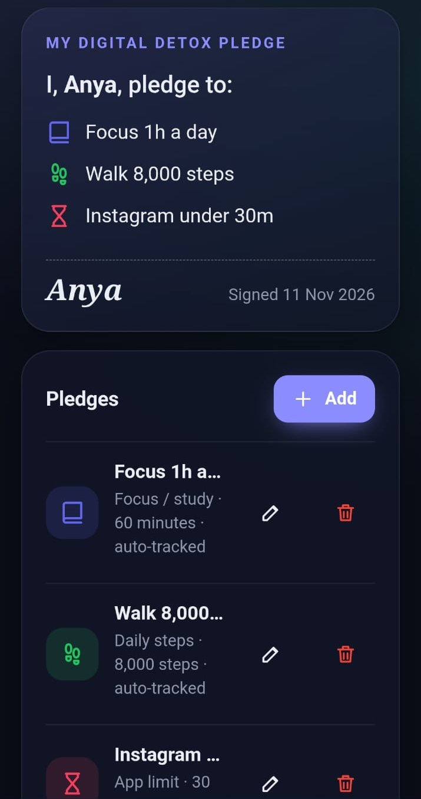<br><sub>My pledge</sub></td>
<td align="center" valign="top" width="33%">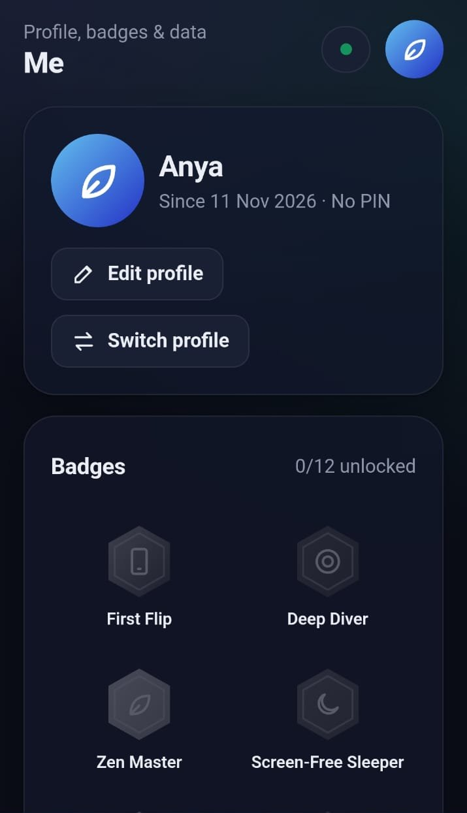<br><sub>Profile</sub></td>
<td align="center" valign="top" width="33%">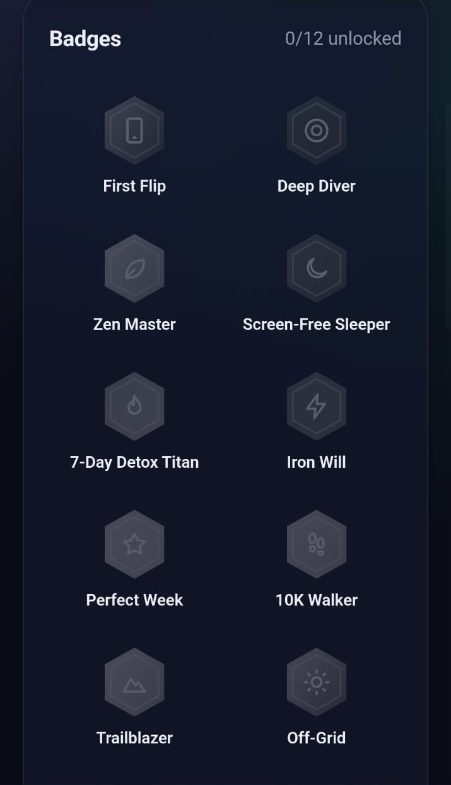<br><sub>Badges</sub></td>
</tr></table>

## ⚙️ Settings & Backup

Theme, sound, haptics, sensitivity and height settings. Back up your data as JSON or as a **.wav sound file**, and check which sensors your device supports.

<table><tr>
<td align="center" valign="top" width="33%">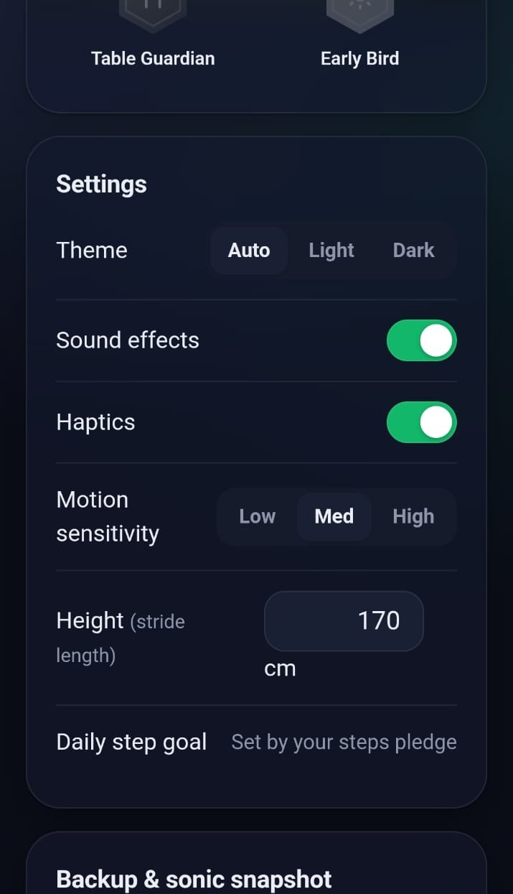<br><sub>Settings</sub></td>
<td align="center" valign="top" width="33%">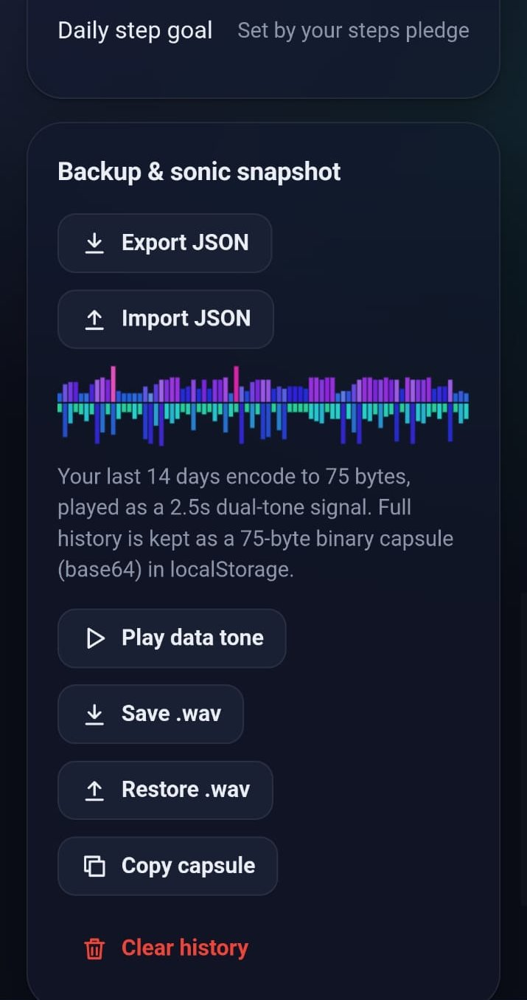<br><sub>Backup & sonic snapshot</sub></td>
<td align="center" valign="top" width="33%">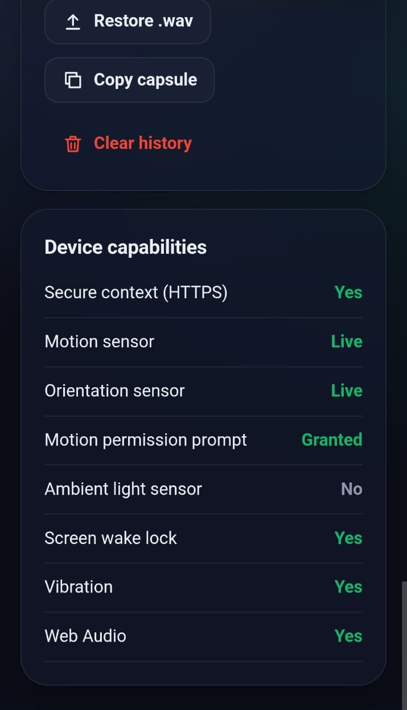<br><sub>Device capabilities</sub></td>
</tr></table>

---

## 🚀 Run & Deploy

```bash
npm install
npm run build      # builds index.html from src/index.html
python3 serve.py   # HTTPS server for testing on your phone
```

**Deploy on Vercel:** import the repo, then choose Framework **Other**, Build command `npm run build`, Output directory `.`

> Motion sensors need **HTTPS**, which Vercel provides automatically. On a laptop, the Detox tab shows a sensor simulator.

**Built with** plain HTML, CSS and JavaScript (one file, about 93 KB, no frameworks).
